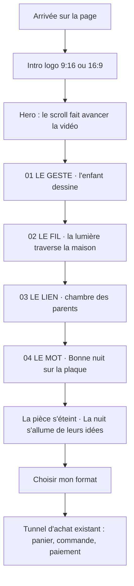

# 03 — App Flow : parcours de la page d'accueil immersive

## Parcours principal (mobile d'abord)

## Écrans et états
| Écran | Déclencheur | Chargement | Réussite | Erreur | Écran suivant |
|---|---|---|---|---|---|
| Intro logo | ouverture de la page | fond Nuit + logo fixe tant que la vidéo n'est pas prête | animation jouée une fois | vidéo indisponible : logo fixe 1 s | hero |
| Hero (plan-séquence) | scroll | image d'attente WebP du format affiché | la vidéo suit le scroll dans les deux sens | vidéo indisponible : images clés fixes + textes | fin |
| Chapitres 01 à 04 | position du scroll | — | titre, mot doré écrit, sous-titre qui s'éclaire | — | chapitre suivant |
| Fin « la pièce s'éteint » | fin de la vidéo | — | pièce assombrie, phrase finale, bouton | — | formats |
| Formats (prototype : ancre) | bouton « Choisir mon format » | — | défilement vers la section | — | tunnel existant |

## Raccourcis
- Bouton « Choisir mon format » du header : saute le hero (US3).
- Mouvement réduit : pas de vidéo pilotée, les quatre chapitres s'affichent sur leurs images clés.

## Questions ouvertes
> Doit être **vide** (ou chaque question tranchée) pour finaliser.
- L'intro est-elle rejouée à chaque visite ?

## Historique
| Version | Date | Changement | Validé par |
|---|---|---|---|
| 0.1 | 2026-10-22 | Création | — |
